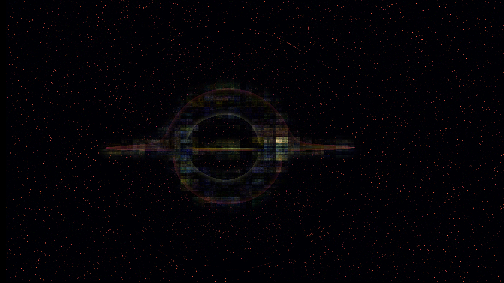
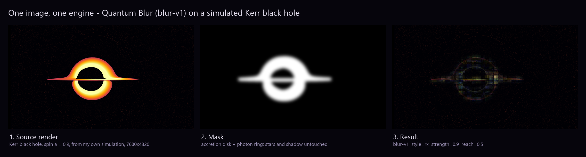

# Fast Scrambler: a quantum blur on a spinning black hole

My entry for **Moth_Hack 2026, Challenge 01: One image, one engine**.



Physicists call black holes the fastest scramblers in nature: information that falls in is mixed across all of the hole's degrees of freedom almost instantly. This project pictures that idea with a real quantum operation. I took a frame from my own simulation of a Kerr black hole (spin a = 0.9) and ran it through Moth's **Quantum Blur** engine, confined by a mask to the accretion disk and photon ring. Inside the mask, the disk's light breaks into a mosaic of colour blocks. The shadow, the thin bright line where the disk crosses the hole and the lensed starfield stay sharp.



## How it works

1. **Source.** A 7680×4320 render of a Kerr black hole from my black-hole simulation (`blackhole/src/kerr.png`).
2. **Mask.** Built from the render's own brightness: threshold, drop isolated stars, grow outward and feather (`disk_mask()` in `blackhole.py`).
3. **Quantum Blur.** The render and mask are uploaded as Atlas assets and sent to `blur-v1`. Quantum Blur encodes image regions into qubit amplitudes, applies a rotation to every qubit and measures the result back into pixels. With `reach` above 0 the rotation mixes amplitudes across the region, so light moves far from where it started. The mask blends the result with the original pixel by pixel.

Final parameters:

| param | value | |
|---|---|---|
| `style` | `rx` | rotation about the Bloch sphere's X axis |
| `strength` | `0.9` | |
| `reach` | `0.5` | halfway between local and fully non-local |
| `size` | `1024` | 20 qubits per pass |
| `downscale` | `true` | |
| `mask` | disk mask | `blackhole/src/kerr_disk_mask.png` |

Emulation only: Quantum Blur runs as a simulation on Atlas, not on a QPU.

## Exploration

I submitted 20 Quantum Blur jobs over two rounds; 18 returned results.

- **Round 1** (`blackhole.py`, contact sheet `blackhole/sheet.png`): strength, reach and `rx`/`ry` on a non-spinning and a spinning render, with and without the mask. Unmasked, any reach above 0 scrambles the black hole beyond recognition (at 0.25 it already makes ghost copies of the hole across the frame). Confining the scramble to the disk is what makes it read as a black hole scrambling its own disk.
- **Round 2** (`blackhole_round2.py`, contact sheet `blackhole/round2_sheet.png`): lower strengths, `ry`, tiling instead of downscaling, a smaller qubit budget, and two other masks: a "horizon" mask that strengthens toward the shadow and an inverted "sky" mask. I kept the disk version because it puts the scrambling where the physics happens.
- **Other engines** (`explore_engines.py`): I also tried Tessa (`tessa-image-v1`) and Deep Fryer (`deep-fryer-v1`). During the hackathon Tessa timed out on every job and Deep Fryer jobs stayed queued, so the entry uses Quantum Blur only.

Every job's ID and parameters are recorded in `blackhole/jobs.json`, `blackhole/round2/jobs.json` and `blackhole/engines/jobs.json`.

## Running it

```sh
pip install -r requirements.txt
cp .env.example .env          # add your Moth Atlas API key
python blackhole.py           # round 1: upload, submit, download to blackhole/out/
python blackhole_round2.py    # round 2: extra masks and settings, to blackhole/round2/
python finalize_blackhole.py  # build submission_blackhole/ from the chosen result
```

The scripts skip jobs already recorded in the `jobs.json` files and just collect their results, so re-running with your own key needs those files removed first. `python finalize_blackhole.py sky_rx0.9_r0.5` (or another variant name) builds the images for a different result into its own folder.

`atlas.py` is a small client for the Atlas REST API: create asset → PUT to the presigned URL → complete → `POST /engines/{id}/process` → poll `/jobs/{id}` → download outputs.

## Files

| path | |
|---|---|
| `atlas.py` | Moth Atlas API client |
| `blackhole.py`, `blackhole_round2.py` | the two Quantum Blur rounds |
| `explore_engines.py` | Tessa and Deep Fryer attempts |
| `finalize_blackhole.py` | submission images |
| `blackhole/src/` | source renders and masks |
| `submission_blackhole/` | `hero.png` (full 8K result), `hero_4k.jpg`, `poster_4x3.jpg`, `before_after.png`, `detail.png` |

Code was written with help from Claude (Claude Code). The source images come from my own simulation; the result is Quantum Blur's output, not AI-generated.
