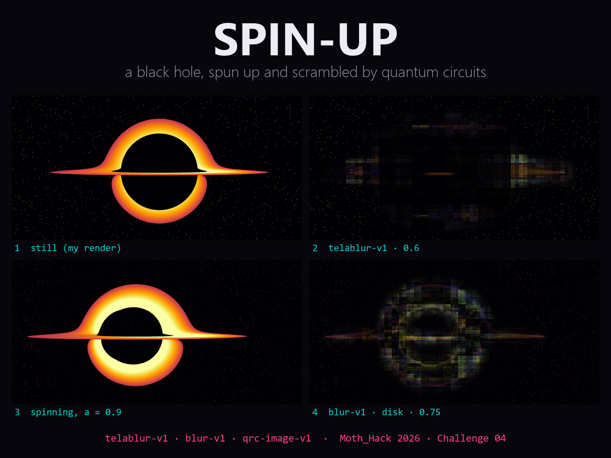

# Spin-up

**A black hole, spun up and scrambled by quantum circuits.** Moth_Hack 2026, Challenge 04 (Moving image).



An 80-second video built from the same Schwarzschild and Kerr renders as [Fast Scrambler](../README.md), cut to my Challenge 02 track [Superposition](https://github.com/VedantMahadik-qc/superposition). Every image you see is a quantum keyframe from Moth Atlas:

| Act | Engine | What happens |
|---|---|---|
| 1 · Spin-up (intro + build) | **telablur-v1** (Quantum Teleblur) | The non-spinning hole is teleported into the spinning one. Both images share one quantum state, and rotating the selector qubit moves the amplitude between them. I ran 9 strengths (0.1–0.9), masked to the hole and disk so the starfield stays put. Midway the disk dissolves into a quantum mosaic and flares into orange bars at 0.6 before the Kerr hole re-forms. |
| 2 · Scramble (drop 1) | **blur-v1** (Quantum Blur) | The Kerr disk is scrambled at 6 strengths (rx, reach 0.5, disk mask). The video cuts on every kick of the track and the strength rises every bar. |
| 3 · Dream (break, build 2, final drop) | **qrc-image-v1** (QRC Image) | A quantum reservoir is trained on all 17 keyframes in story order and generates its own 96-frame sequence. It learns the spin-up and the scramble but improvises: it turns back early, oscillates at the peak, and stutters at the start. The returned GIF is matched frame by frame back to the 1080p keyframes and cut to the final drop. The strip at the bottom of the frame is that generated sequence. |

## Files

- `run_jobs.py`: the Quantum Blur sweep (and the first, unmasked Teleblur sweep). `fetch_masked.py` collects the masked Teleblur sweep.
- `run_qrc.py`: trains the reservoir and maps the GIF back to keyframes (`qrc/sequence.json`). The raw GIF, reservoir state and job record are in `qrc/`.
- `make_video.py`: renders `spin-up.mp4` (1920×1080, 30 fps) with PIL and ffmpeg. Cuts follow the kick and snare times in Superposition's MIDI.
- `inputs/`, `teleblur_masked/`, `blur/`: the 1080p sources and every quantum keyframe. `jobs*.json` holds the job IDs and parameters.

```bash
# needs the superposition repo next to this one (for synth.py, the MIDI and the track)
export SUPERPOSITION_DIR=../superposition/02_audible/superposition
ffmpeg -i ../superposition/audio/superposition.mp3 superposition.wav
export SUPERPOSITION_WAV=superposition.wav
python spin-up/make_video.py
```
